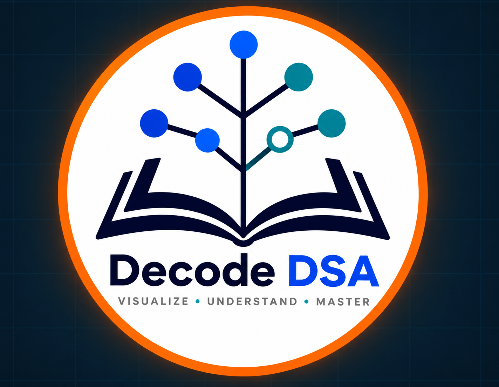
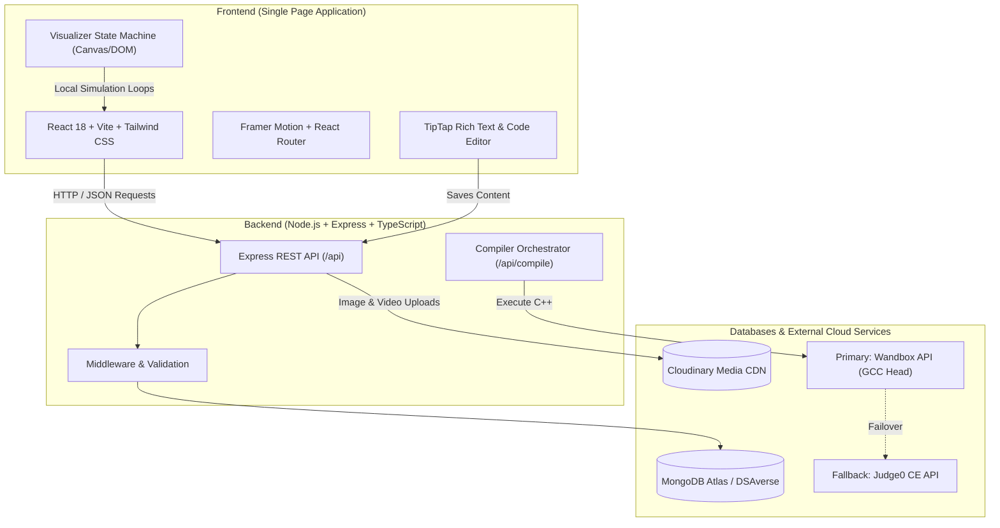

# 🚀 DecodeDSA — Interactive Data Structures & Algorithms Learning Platform

<div align="center">

[](https://react.dev/)
[](https://www.typescriptlang.org/)
[](https://nodejs.org/)
[](https://www.mongodb.com/)
[](https://tailwindcss.com/)
[](https://vitejs.dev/)
[](https://opensource.org/licenses/MIT)

**A next-generation, full-stack educational platform engineered to make Data Structures & Algorithms intuitive through interactive visual state machines, real-time C++ compilation, and structured curriculums.**

[Explore Live Demo](#-live-demo--preview) • [Key Features](#-core-features) • [System Architecture](#-system-architecture) • [Engineering Highlights](#-engineering-highlights) • [Local Setup](#-getting-started)

</div>

---

## 📌 Problem Statement

Traditional DSA learning often leaves students navigating between abstract theory, disconnected online IDEs, and static code snippets. Beginners struggle with:
1. **Mental Model Gaps:** Visualizing how pointers, indices, and memory states change during sorting or traversal.
2. **Context Switching:** Toggling between lecture notes, compiler tabs, and problem trackers.
3. **Passive Consumption:** Reading algorithms without immediate active testing and step-by-step verification.

**DecodeDSA** solves this by unifying **interactive step-by-step visualizations**, a **cloud-backed real-time C++ execution engine**, and **rich interactive lesson modules** into a single cohesive workspace.

---

## 🌐 Live Demo & Preview

> **Live Deployment:** [DecodeDSA on Vercel](https://github.com/RishiDangi-32/DecodeDSA) *(Update with your production URL)*  
> **API Server:** Hosted on Render / Railway

<div align="center">
  
</div>

---

## ✨ Core Features

### 1. 🎨 Step-by-Step Interactive Visualizer
* **Algorithmic State Machines:** Real-time visual execution for Sorting (*Bubble Sort, Selection Sort*) and Searching (*Linear Search, Binary Search*).
* **Granular Playback Control:** Play, pause, step forward, randomize input array, and adjust simulation speeds dynamically (from 100ms to 1200ms delay).
* **Pointer & Range Tracking:** Clear visual cues for active comparison indices, sorted partitions, binary search intervals (`low`, `mid`, `high`), and found targets.

### 2. ⚡ In-Browser C++ Code Compiler & Terminal
* **Zero-Setup Online Execution:** Write and run modern C++ code directly in the browser with standard input (`cin`) and output (`cout`) streaming.
* **Dual-Tier Resilient Engine:** Backed by a failover compiler infrastructure utilizing Wandbox (GCC-Head) with automatic fallback to Judge0 CE.
* **Developer Experience:** Code templates for standard competitive programming headers (`<vector>`, `<algorithm>`, `<iostream>`), error line diagnostics, and terminal reset utilities.

### 3. 📚 Structured Curriculum & Lesson Workspace
* **Modular Learning Paths:** Organized hierarchy of Courses ➔ Modules ➔ Lessons with integrated progress tracking.
* **Interactive Quizzes:** In-lesson knowledge validation with multiple-choice questions, instant feedback, and answer explanations.
* **Rich Text Notes:** Built with TipTap (ProseMirror engine), featuring syntax-highlighted code blocks (lowlight), tables, YouTube video embeds, and media attachments.

### 4. 🛠️ Administrative & Course Management CMS
* **Content Management Dashboard:** Role-ready interfaces to create, update, and manage courses, curriculum modules, and interactive lessons.
* **Media Cloud Library:** Direct asset upload pipeline integrated with Cloudinary for persistent media hosting.
* **Aggregated Statistics:** Metrics tracking total courses, active lessons, media consumption, and learning progress.

---

## 🏗️ System Architecture



---

## 💻 Tech Stack

| Domain | Technology | Purpose |
| :--- | :--- | :--- |
| **Frontend Framework** | **React 18 + Vite** | Fast SPA rendering, component modularity, and lightning-fast HMR |
| **Language** | **TypeScript** | Strict compile-time type safety across frontend UI and backend APIs |
| **Styling & Motion** | **Tailwind CSS + Framer Motion** | Glassmorphic cyber theme, responsive grids, and fluid layout transitions |
| **Rich Text Engine** | **TipTap / ProseMirror** | Extensible WYSIWYG documentation editor with lowlight syntax highlighting |
| **Backend API** | **Node.js + Express** | High-throughput asynchronous REST API server |
| **Database** | **MongoDB Atlas + Mongoose** | Flexible document store for courses, modules, lessons, and quiz questions |
| **Media Storage** | **Cloudinary API** | Secure media uploads, CDN distribution, and asset transformations |
| **Code Execution** | **Wandbox + Judge0 CE** | Remote code sandboxing, compilation, and execution telemetry |

---

## 🔬 Engineering Highlights

### 1. Resilient Multi-Tier Code Execution Pipeline
Rather than relying on a single third-party execution API that could be rate-limited or experience downtime, the backend implements a resilient failover strategy:
- Requests hit the **Wandbox API (`gcc-head`)** first for sub-second C++ compilation.
- If network timeouts or 5xx responses occur, the orchestrator seamlessly catches the exception, base64-encodes the code and standard input, and dispatches the payload to **Judge0 CE** without failing the user's session.
- Exit codes, execution duration, compiler errors, and runtime signals are normalized into a single predictable response contract.

### 2. Deterministic Visualizer State Machine
To guarantee smooth 60fps algorithm animations without React re-render thrashing:
- The algorithm simulator separates calculation from presentation: steps are pre-computed into a serializable queue (`stepsRef`).
- Playback uses mutable execution pointers and non-blocking timers (`useRef`), decoupling visualization frame rates from component state reconciliation.
- Enables instant pause, step-by-step traversal, and dynamic speed interpolation on the fly.

### 3. ProseMirror / TipTap Custom Content Pipeline
- Integrated `@tiptap/extension-code-block-lowlight` with lowlight language definitions for C++, Python, and JavaScript.
- Configured modular schema nodes for interactive tables, responsive image resizing, and sanitized YouTube embeds directly within course lessons.

---

## 📂 Project Structure

```
DecodeDSA/
├── backend/                    # Express + TypeScript API server
│   ├── src/
│   │   ├── config/            # Database (MongoDB) and Cloudinary configs
│   │   ├── controllers/       # Controller logic (courses, lessons, compiler, etc.)
│   │   ├── middleware/        # Error handlers and file upload interceptors
│   │   ├── models/            # Mongoose data schemas (Course, Module, Lesson, Media)
│   │   ├── routes/            # REST API route handlers
│   │   └── index.ts           # Server entry point
│   ├── .env.example           # Environment template for backend secrets
│   └── package.json
│
├── src/                        # React + TypeScript Frontend
│   ├── assets/                # Static brand graphics and illustrations
│   ├── components/
│   │   ├── dashboard/         # Sidebar, Navbar, and Dashboard layouts
│   │   ├── Landing Page/      # Hero, Features, Roadmap, Developer spotlights
│   │   └── ui/                # CodeCompiler, InteractiveVisualizer, LessonQuiz, TipTap
│   ├── pages/
│   │   ├── admin/             # CMS portals (Courses, Lessons, Modules, Media)
│   │   └── student/           # Learning workspaces, Course details, Explorers
│   ├── services/              # Axios/Fetch API client abstractions
│   ├── types/                 # Shared TypeScript interfaces
│   ├── App.tsx                # Client-side router and view management
│   └── main.tsx               # DOM mount entry
├── .gitignore                 # Protected secret filters
├── package.json               # Frontend dependencies & Vite scripts
└── tailwind.config.js         # Custom colors, glows, and responsive typography
```

---

## 🚀 Getting Started

Follow these steps to run the complete stack locally on your machine.

### Prerequisites
* [Node.js](https://nodejs.org/) (v18.x or later)
* [Git](https://git-scm.com/)
* A free [MongoDB Atlas](https://www.mongodb.com/) cluster URI
* A free [Cloudinary](https://cloudinary.com/) account

### 1. Clone the Repository
```bash
git clone https://github.com/RishiDangi-32/DecodeDSA.git
cd DecodeDSA
```

### 2. Set Up the Backend
```bash
cd backend
npm install
```

Create a `.env` file in the `backend/` directory based on `.env.example`:
```env
PORT=5000
MONGO_URI=your_mongodb_connection_string
CLOUDINARY_CLOUD_NAME=your_cloud_name
CLOUDINARY_API_KEY=your_api_key
CLOUDINARY_API_SECRET=your_api_secret
```

Build and run the backend server:
```bash
npm run dev
# Backend server runs at http://localhost:5000
```

### 3. Set Up the Frontend
Open a new terminal window at the project root:
```bash
npm install
npm run dev
# Frontend web application opens at http://localhost:5173
```

---

## 🔌 API Endpoints Summary

| Method | Endpoint | Description |
| :--- | :--- | :--- |
| `POST` | `/api/compile` | Compiles & runs C++ code with stdin inputs via Wandbox/Judge0 |
| `GET` | `/api/courses` | Retrieves all published courses and curriculum outlines |
| `GET` | `/api/modules` | Retrieves modules associated with specific course tracks |
| `GET` | `/api/lessons/:id` | Fetches lesson content, TipTap markup, and attached quizzes |
| `POST` | `/api/media/upload`| Uploads image/video assets directly to Cloudinary storage |
| `GET` | `/api/stats` | Returns aggregated metrics for courses, lessons, and engagement |
| `GET` | `/health` | Server health check endpoint |

---

## 👨‍💻 Developer & Team

* **Rishi Dangi** — Lead Full-Stack Architect & Core Developer
  * [GitHub](https://github.com/RishiDangi-32) • [LinkedIn](https://linkedin.com/in/)
* **Madhav Institute of Technology and Science (MITS-DU)**

---

## 📄 License

This project is licensed under the [MIT License](LICENSE).
